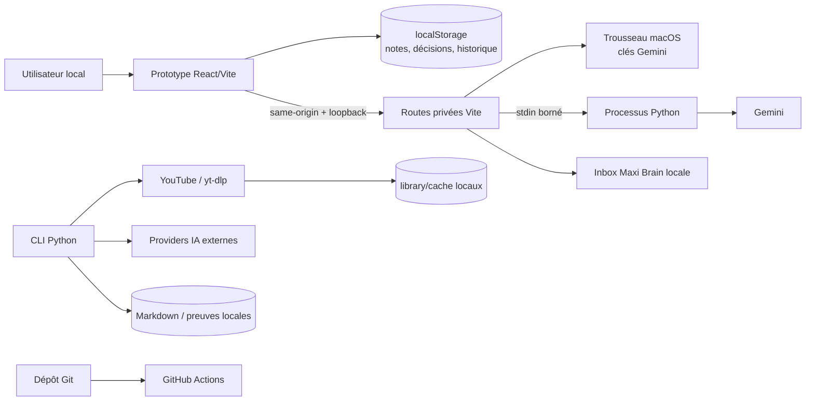
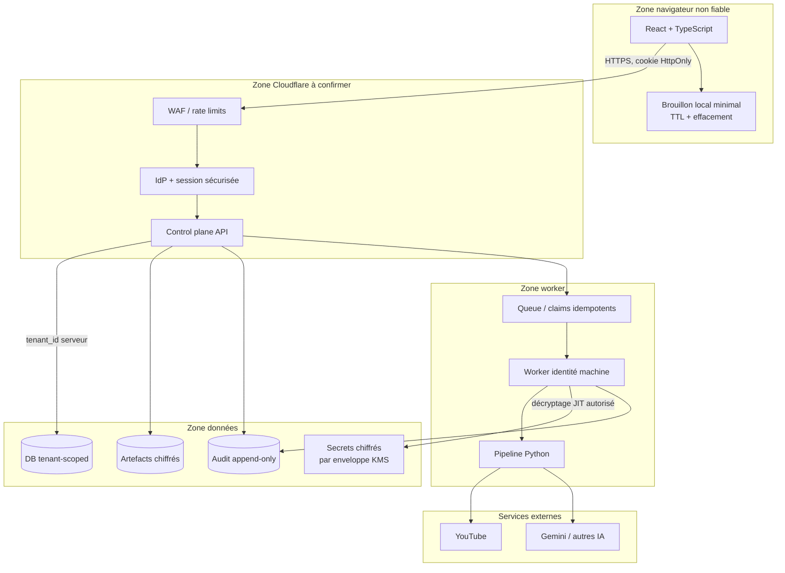

# Architecture de sécurité du projet Transcript

> Statut : `draft_to_validate`
> Audit réalisé le : 2026-11-08
> Périmètre : dépôt local `/Users/insular/transcripts` et configuration GitHub publique
> `Insular2895/summarizer` observée en lecture seule.

## 1. Conclusion d'architecture

Le dépôt n'est pas encore un SaaS multi-tenant déployable. L'existant est composé d'un pipeline
Python local, de deux prototypes React/Vite, de routes privées de développement accessibles
uniquement sur loopback et de Workers statiques. Le control plane Cloudflare, la base durable,
l'authentification humaine, les organisations, les rôles, l'isolation tenant, l'administration et
les paiements ne sont pas implémentés.

Cette distinction est structurante : l'absence d'authentification n'est pas aujourd'hui un bypass
exploitable sur un backend SaaS inexistant, mais elle interdit de transformer les routes locales en
API publique. Le futur backend devra être construit fail-closed autour de l'identité, du tenant et
de l'autorisation objet avant toute mise en production.

L'architecture cible ci-dessous est une proposition conditionnelle. Elle ne vaut ni décision de
fournisseur, ni autorisation de déploiement.

## 2. Architecture réellement observée

| Zone | Implémentation actuelle | Données / privilèges | Exposition |
| --- | --- | --- | --- |
| Pipeline | Python 3.11, CLI, `yt-dlp`, extraction PDF, clients Gemini/Anthropic/OpenAI-compatible | URLs, cookies YouTube locaux, transcripts, PDF, prompts, sorties, clés provider | Processus local ou conteneur local |
| Frontend principal | `prototypes/fluid-knowledge-web`, React/Vite JavaScript | Playlist 32, décisions, historique et notes dans `localStorage` | Prototype local et build statique |
| Second prototype | `prototypes/fluid-knowledge`, React/Vite TypeScript | Démonstrateur mobile | Build statique |
| API locale | Plugins Vite : clés API, Gemini, export Maxi Brain, capacités | Clés Gemini dans le Trousseau, contexte sélectionné, écritures dans le vault local | Loopback, même origine, non destinée à Internet |
| Hébergement statique | Workers servant les assets et le fallback SPA | Aucun D1, aucun R2, aucune API de production | Statique seulement |
| CI | Un workflow Python : format, lint, mypy non bloquant, pseudo secret scan, tests | Code du dépôt | GitHub Actions |
| GitHub | Dépôt public, branche `main` non protégée, aucune ruleset, Actions autorisées sans obligation de SHA | Code et historique Git | Public |

Intégrations effectivement présentes : YouTube/`yt-dlp`, Gemini, Anthropic, fournisseurs
OpenAI-compatible et export local Maxi Brain. Aucune intégration Stripe, Supabase ou Firebase n'a
été trouvée dans le code applicatif. Aucun mécanisme white-label n'a été trouvé.

## 3. Flux de données actuel

### Frontières de confiance

1. Navigateur local ↔ serveur Vite local.
2. Serveur local ↔ Trousseau macOS et système de fichiers.
3. Processus Python ↔ YouTube, GitHub pour les composants EJS et fournisseurs IA.
4. Dépôt local ↔ dépôt GitHub public.
5. CI GitHub ↔ actions et images tierces.
6. Futur navigateur public ↔ futur control plane : frontière non implémentée.

### Actifs critiques

- cookies de session YouTube ;
- clés API utilisateur et éventuelles clés de service ;
- transcripts, PDF, notes et résumés pouvant contenir des données personnelles ;
- coûts et quotas des fournisseurs IA ;
- compte GitHub, workflows et futurs identifiants de déploiement ;
- futur mapping `user_id` / `tenant_id` / ressources ;
- futurs rôles administrateur et journaux d'audit.

## 4. Contrôles déjà utiles

- `.env`, `cookies.txt`, cache, PDF et outputs sont exclus du contexte Docker.
- Les clés Gemini du prototype local sont stockées dans le Trousseau macOS ; le navigateur ne
  reçoit que leur état de configuration.
- Les routes privées locales vérifient l'adresse loopback ; les mutations exigent une origine
  correspondant au `Host`.
- Les corps des routes Clés API et Gemini sont bornés et validés.
- Le processus Gemini enfant reçoit la clé par entrée standard et son environnement est purgé des
  noms de secrets provider connus.
- Les commandes de sous-processus observées utilisent des tableaux d'arguments, sans shell.
- Le contenu de transcript est traité comme donnée non fiable dans le prompt et ne déclenche pas
  d'outil.
- Les Workers statiques ne transforment pas une route API ou une mutation inconnue en succès SPA.

Ces contrôles réduisent le risque local. Ils ne constituent pas une authentification SaaS.

## 5. Architecture cible proposée

### Invariants obligatoires

- Le client ne choisit jamais son `user_id`, son `tenant_id`, son rôle, son quota ou le prix.
- Chaque requête et chaque objet sensible sont autorisés côté serveur.
- Les requêtes DB incluent le tenant issu de la session serveur ; les identifiants seuls ne
  suffisent jamais à autoriser une ressource.
- Une identité machine distincte traite les jobs avec un claim court, révocable et minimal.
- Les clés utilisateur sont chiffrées par enveloppe, déchiffrées juste-à-temps pour un appel
  autorisé et jamais révélées par une route d'administration.
- Les artefacts et logs ne contiennent ni clés, ni cookies, ni corps provider bruts.
- Les quotas IA sont atomiques côté serveur, par utilisateur, tenant, usage et fenêtre temporelle.
- Les mutations critiques sont idempotentes et auditables.
- Les sauvegardes sont chiffrées ; la restauration est testée, pas seulement configurée.

### Modèle de garde des secrets

Le Trousseau macOS reste adapté au mode local mono-utilisateur. Pour le SaaS :

1. Les clés de plateforme vivent dans un gestionnaire de secrets du runtime, pas dans la DB.
2. Une clé BYOK utilisateur est chiffrée avec une clé de données unique.
3. La clé de données est enveloppée par une clé KMS ; la DB conserve seulement ciphertext,
   enveloppe, provider, finalité, version et métadonnées non sensibles.
4. Une autorisation tenant + utilisateur + finalité est vérifiée avant décryptage.
5. Le worker déchiffre en mémoire le temps de l'appel, sans log ni retour au navigateur.
6. Rotation, révocation, suppression et audit sont disponibles sans fonction « afficher la clé ».

Ce modèle n'est pas zero-knowledge : le service appelant le provider doit pouvoir utiliser la clé en
mémoire.

## 6. Pertinence réelle des outils demandés

La mission annonce six projets, mais n'en nomme que cinq. GitHub Actions est l'orchestrateur et ne
doit pas être compté silencieusement comme un sixième scanner. Le sixième projet reste à préciser.

| Outil | Pertinence maintenant | Responsabilité retenue | Limites |
| --- | --- | --- | --- |
| Vibe Security Skill 1.0 | Utile comme grille de revue IA | Revue contextuelle des diffs : secrets, confiance client, auth, quotas IA, paiements si ajoutés | Projet jeune (4 commits observés), résultat non déterministe, jamais un gate autonome |
| Semgrep | Forte | SAST Python, JS/TS, Dockerfile, workflows ; règles locales sur erreurs provider, sous-processus et frontières API | Ne prouve pas l'autorisation métier ni l'isolation tenant |
| Gitleaks | Critique | Historique Git, nouveaux commits, fichiers et patterns personnalisés | Une alerte supprimée ne révoque pas le secret ; rotation obligatoire |
| Trivy | Forte | Lockfiles, dépendances, Dockerfile/image, misconfigurations et SBOM | Sans lock Python, la version réellement déployée reste ambiguë ; ne remplace pas Gitleaks |
| ZAP | Faible aujourd'hui, forte après staging | Baseline passive sur preview ; scan actif autorisé sur préproduction | Ne détecte pas correctement les IDOR/règles métier ; aucun scan actif production |
| Sixième projet | Non défini | À décider | Aucune intégration possible sans nom et périmètre |

Pour éviter les doublons, Gitleaks possède la détection de secrets. Trivy doit être limité aux
scanners `vuln,misconfig` et à la génération SBOM dans ce pipeline.

## 7. Contrôles complémentaires

| Contrôle | État actuel | Automatisation cible | Revue humaine |
| --- | --- | --- | --- |
| Isolation tenant / organisation | Impossible à tester : modèle absent | Tests A/B avec deux tenants, contraintes DB, requêtes négatives | Threat model et revue du schéma |
| Accès horizontal / vertical | Impossible à tester côté SaaS | Tests d'intégration pour chaque rôle et ressource | Revue de matrice d'autorisations |
| Autorisation objet | Non implémentée | Fixtures généralisées sur tous les endpoints sensibles | Vérification des exceptions métier |
| Signature webhook Stripe | Non applicable : Stripe absent | Test signature valide/invalide/replay si Stripe est ajouté | Revue des événements et remboursements |
| Opérations administrateur | Non applicable : admin absent | MFA/step-up, journal append-only, tests d'escalade | Double contrôle pour actions destructrices |
| Sessions / cookies / récupération | Non implémentés | Tests expiration, révocation, fixation, CSRF et récupération | Revue IdP et scénarios d'abus |
| Abus API et coûts IA | Partiel en local | Limites atomiques, quotas, budget, idempotence, alertes | Choix des seuils et procédure d'exception |
| Sauvegarde / restauration | Impossible : DB absente | Backups chiffrés et vérification d'intégrité | Exercice de restauration périodique |
| Journalisation critique | Partielle et locale | Événements structurés redacted, alertes et rétention | Revue des événements et accès aux logs |
| Autorisation white-label | Non applicable / non décidée | Tests tenant, domaines et thèmes si retenu | Décision produit préalable |

## 8. Décisions et hypothèses à valider

- **Fait** : aucun backend multi-tenant n'est implémenté.
- **Fait** : l'architecture Cloudflare visée est documentée, mais sa topologie exacte reste ouverte.
- **Fait** : aucune intégration Stripe/Supabase/Firebase ni white-label n'est présente.
- **Inférence** : le schéma futur doit être multi-tenant si plusieurs clients utilisent le service ;
  cela ne valide pas encore une offre white-label.
- **Proposition** : control plane fail-closed, DB tenant-scoped, secrets BYOK chiffrés par enveloppe,
  workers à identité machine et audit append-only.
- **Décision requise** : fournisseur d'identité, topologie Cloudflare, base durable, gestionnaire KMS,
  politique de conservation et sixième projet de sécurité.

## 9. Sources

### Dépôt et outils locaux

- `Readme.md`, `docs/ARCHITECTURE.md`, `docs/SAFETY.md`, `docs/WEB_V1_ARCHITECTURE.md`,
  `docs/WEB_V1_IMPLEMENTATION_PLAN.md`.
- `src/`, `prototypes/`, Dockerfile, Compose, workflow CI et configuration GitHub consultée via API
  en lecture seule.
- Baselines du vault Maxi Brain : application security, IAM, supply chain CI, sécurité du code IA et
  garde des clés utilisateur.

### Sources primaires externes consultées le 2026-11-08

- [Vibe Security Skill](https://github.com/raroque/vibe-security-skill) et son
  [processus d'audit](https://github.com/raroque/vibe-security-skill/blob/main/vibe-security/SKILL.md).
- [Semgrep — configurations CI officielles](https://docs.semgrep.dev/semgrep-ci/sample-ci-configs).
- [Gitleaks Action](https://github.com/gitleaks/gitleaks-action).
- [Trivy — scan de dépôt](https://trivy.dev/docs/latest/target/repository/).
- [ZAP — scans Docker](https://www.zaproxy.org/docs/docker/).
- [GitHub — durcissement des workflows](https://docs.github.com/en/code-security/tutorials/secure-your-organization/protect-against-threats).
- [yt-dlp — composants EJS](https://github.com/yt-dlp/yt-dlp/wiki/EJS).
