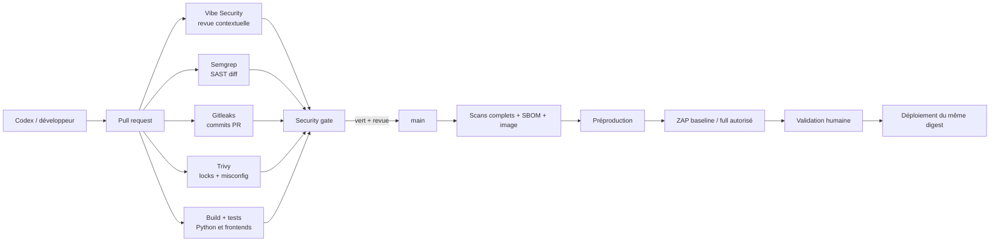

# Plan CI/CD de sécurité Transcript

> Statut : conception uniquement, `draft_to_validate`.
> Aucun workflow ou outil n'a été installé dans le dépôt.

## 1. Objectifs

- Retour PR rapide et pertinent.
- Analyse complète de `main` et de l'artefact réellement déployé.
- Blocage uniquement sur les nouveaux risques critiques/hauts confirmés, les secrets ou les
  violations d'invariants.
- Aucun secret disponible lors de l'exécution de code provenant d'une PR non fiable.
- Rapports redacted et exceptions temporaires traçables.

## 2. Flux d'orchestration

## 3. Matrice d'exécution

| Contrôle | Pull request | `main` | Pré-déploiement | Planifié |
| --- | --- | --- | --- | --- |
| Qualité/tests Python | Oui | Oui | Réutiliser résultats signés | — |
| Build/tests React/Vite | Oui si chemins concernés, sinon cache | Oui | Smoke test du build | — |
| Vibe Security | Diffs sensibles et revue ciblée | Rapport complet après gros merge | Revue du delta release | Trimestriel / changement majeur |
| Semgrep | Diff / règles haut signal | Scan complet + SARIF | Vérifier aucun finding nouveau | Quotidien ou hebdo |
| Gitleaks | Commits PR, bloquant | Historique complet | Vérification artefact/config | Quotidien |
| Trivy repo | Locks + Docker + misconfig | Complet | — | Base CVE fraîche, hebdo |
| Trivy image/SBOM | Si Dockerfile/lock change | Image finale + SBOM | Même digest uniquement | Re-scan des digests actifs |
| ZAP baseline | Preview si application HTTP déployable | Staging après merge | Oui | Hebdomadaire |
| ZAP full actif | Non par défaut | Non | Staging autorisé, release majeure | Mensuel / changement critique |
| Tests authz/tenant | Dès que backend présent | Oui | Oui | — |
| Restore drill | — | — | Avant lancement | Trimestriel |

## 4. Workflows envisagés

### `ci-pr.yml` — code non fiable, aucun secret

- Trigger `pull_request`, jamais `pull_request_target` pour construire/tester le code.
- `permissions: contents: read` au niveau workflow.
- Installation déterministe (`pip` depuis lock + hashes, `npm ci`).
- Format, lint, typecheck bloquant selon baseline ratifiée, tests et builds.
- Gitleaks sur la plage de commits de la PR avec checkout complet si nécessaire.
- Semgrep CE sur les langages réellement présents.
- Trivy `vuln,misconfig`, secrets désactivés pour ne pas doubler Gitleaks.
- Aucun token provider, Cloudflare, KMS ou déploiement.
- `concurrency` par PR et annulation des runs obsolètes.

### `security-main.yml` — analyse complète

- Trigger `push` sur `main`, manuel et planifié.
- Gitleaks historique complet.
- Semgrep complet.
- Trivy repo, build image, scan image puis SBOM CycloneDX ou SPDX.
- Rapports SARIF dans un job séparé dont la seule permission additionnelle est
  `security-events: write` si GitHub Code Scanning est utilisé.
- Conservation courte des rapports redacted ; aucun contenu utilisateur.

### `release-security.yml` — artefact de préproduction

- Trigger sur candidat release ou promotion manuelle.
- Ne rebuild pas : récupère le digest produit par le job de confiance.
- Vérifie provenance, signature, SBOM et Trivy image.
- Déploie en staging avec OIDC et environnement GitHub protégé.
- Lance tests d'autorisation/tenant puis ZAP baseline.
- ZAP full seulement avec cible allow-listée, autorisation et garde environnementale.

### `scheduled-security.yml` — dérive dans le temps

- Rafraîchissement des bases CVE et re-scan des images actives.
- Gitleaks historique complet.
- Semgrep complet après mise à jour contrôlée des règles.
- ZAP baseline staging hebdomadaire ; full mensuel ou après changement majeur.
- Ouvre une issue sans secret ou donnée client, avec propriétaire et SLA.

## 5. Politique de blocage

Bloquer automatiquement :

- secret confirmé ou chemin privé interdit ;
- nouveau Semgrep `ERROR`/haut signal sur code modifié ;
- vulnérabilité Trivy critique/haute avec correctif, présente dans l'artefact runtime et non couverte
  par une exception valide ;
- misconfiguration critique du Dockerfile/CI/IaC ;
- échec build/test, authz/tenant, SBOM ou provenance ;
- ZAP `FAIL` confirmé sur staging pour la release ;
- action non épinglée par SHA ou permissions plus larges que la policy.

Ne pas bloquer automatiquement sans triage :

- résultat Vibe Security seul ;
- CVE sans version installée déterminable à cause d'un manifest non verrouillé ;
- ZAP `WARN` passif non reproduit ;
- finding ancien accepté dans une baseline approuvée ;
- vulnérabilité dev-only absente de l'artefact, mais elle reste suivie.

## 6. Faux positifs et exceptions

Chaque exception doit contenir : ID de finding, justification technique, portée exacte, propriétaire,
date d'expiration maximale de 30 jours, ticket de correction et approbation sécurité. Elle ne doit
jamais contenir la valeur d'un secret.

- Gitleaks : allow-list par fingerprint/chemin minimal, jamais une regex trop large.
- Semgrep : `nosemgrep` exceptionnel, accompagné d'une justification et d'un test compensatoire.
- Trivy : VEX ou ignore avec CVE, artefact/digest et date d'expiration.
- ZAP : fichier de règles versionné ; `IGNORE` seulement après reproduction et analyse.

Une baseline sert à distinguer dette existante et régression ; elle ne transforme pas une faille en
comportement sûr.

## 7. Durcissement GitHub Actions

- Protéger `main` et exiger review + checks.
- `permissions: { contents: read }` par défaut ; élever uniquement un job précis.
- Épingler toutes les Actions tierces et GitHub par SHA complet revu.
- Autoriser seulement les éditeurs/actions nécessaires.
- Mettre à jour les SHA via Dependabot/Renovate avec revue du changelog.
- Interdire la construction de code PR non fiable dans `pull_request_target` ou un workflow doté de
  secrets.
- Runners éphémères ; aucun runner self-hosted partagé avec le réseau interne sans isolation.
- Déploiement OIDC à credential court, lié au repo, à la branche et à l'environnement.
- Environnement production avec approbation humaine et restriction de branche.
- Caches séparés non fiables/de confiance ; aucune restauration de cache PR dans un job privilégié.
- Artifacts minimisés, checksums, rétention courte et absence de transcripts/cookies/clés.
- CODEOWNERS sur `.github/`, secrets, auth, paiement, migrations et policy sécurité.

L'état GitHub observé exige ces changements : `main` n'est pas protégée, aucune ruleset n'existe,
toutes les Actions sont autorisées et le pin SHA n'est pas exigé. Le token workflow par défaut est
déjà en lecture seule, ce qui est à préserver.

## 8. Versions et provenance

Versions observées dans les sources officielles le 2026-11-08 ; elles sont des candidats, pas des
versions intégrées :

| Composant | Version observée | Politique d'intégration |
| --- | --- | --- |
| Vibe Security Skill | métadonnée 1.0 | Auditer puis pinner un commit exact ; ne pas installer depuis `main` en CI |
| Semgrep | v1.184.0 | Image ou binaire versionné + digest/checksum ; ne pas utiliser `semgrep-action` archivée |
| Gitleaks Action | v3 | Action au SHA complet ; version moteur explicite, jamais `latest` |
| Gitleaks moteur | v8.30.1 observée | Vérifier provenance du tag et test canari avant adoption ; un ticket amont signale que le tag n'est pas ancêtre de `master` |
| Trivy Action | v0.36.0 | Action au SHA complet et `trivy-version` explicite |
| Trivy moteur | v0.76.2 | Checksum/signature ou digest OCI, base CVE mise en cache de façon sûre |
| ZAP Baseline Action | v0.15.0 | SHA complet et image ZAP épinglée par digest |
| ZAP Full Scan Action | v0.13.0 | SHA complet ; staging autorisé uniquement |

La vérification finale doit être refaite le jour de l'intégration. Un tag signé ou « latest » ne
remplace pas la revue du commit, du digest et du changelog.

## 9. Configuration par outil

### Vibe Security

- Déclencher sur les diffs touchant API, auth, DB, secrets, IA, paiement, admin et CI.
- Produire constats avec fichier/ligne, preuve, sévérité, statut confirmé/suspicion.
- Ne jamais lui donner de secret ni exécuter automatiquement ses corrections.
- Une personne valide les constats critiques et les exceptions.

### Semgrep

Périmètre : Python, JavaScript/TypeScript/JSX/TSX, Dockerfile, YAML GitHub Actions.

Règles locales candidates :

- interdiction de `shell=True` et de commandes construites depuis une entrée ;
- détection des corps provider bruts incorporés aux exceptions ;
- interdiction de tokens/secrets dans `localStorage` et variables `VITE_*` ;
- détection de `remote_components` yt-dlp non approuvé ;
- routes mutantes sans guard/authz une fois le control plane créé ;
- URLs provider contrôlées par l'utilisateur ;
- workflow avec `|| true`, permissions larges ou `pull_request_target` dangereux.

### Gitleaks

- `fetch-depth: 0` pour les scans historiques.
- Règles standard + patterns projet (cookies Netscape, clés provider, tokens Cloudflare).
- PR : plage de commits ; main/schedule : historique complet.
- Logs et SARIF redacted ; désactiver commentaires si risque d'exposition.
- Toute fuite confirmée déclenche rotation, évaluation d'accès et purge Git séparée.
- Sous compte GitHub personnel, l'Action ne demande pas de licence ; une migration vers une
  organisation devra réévaluer cette contrainte selon la documentation du projet.

### Trivy

- PR : repository/lockfiles et misconfigurations.
- Main : image finale et SBOM.
- `--scanners vuln,misconfig` pour éviter le doublon secret.
- Gate sur runtime corrigible ; suivi distinct des dépendances de développement.
- Pas de conclusion CVE précise avant lock Python.

### ZAP

- Baseline passive : preview/staging ; utile pour headers, cookies et configuration HTTP.
- Full/actif : préproduction isolée, données synthétiques, comptes de test, e-mails neutralisés,
  périmètre allow-listé et autorisation explicite.
- Jamais d'actif sur production sans nouvelle autorisation écrite.
- Authentification configurée pour deux utilisateurs/tenants ; compléter par des tests métier, car
  ZAP ne prouve pas l'absence d'IDOR.

## 10. Performance et coûts

- Gitleaks + Semgrep + Trivy repo en parallèle sur PR.
- Path filters pour éviter de rebuild les deux prototypes sans changement, mais scan secret global
  toujours actif.
- Cache des dépendances indexé par lockfile ; cache Trivy séparé et protégé.
- Objectif PR : moins de 10 minutes ; full scan/image/SBOM sur `main`.
- ZAP baseline après disponibilité de preview ; full scan hors chemin critique PR.
- Vibe Security ciblé par chemins à risque, puis revue complète à chaque release majeure.

## 11. Sources officielles

- [Semgrep CI](https://docs.semgrep.dev/semgrep-ci/sample-ci-configs)
- [Gitleaks Action](https://github.com/gitleaks/gitleaks-action)
- [Trivy repository scanning](https://trivy.dev/docs/latest/target/repository/)
- [Trivy CI/CD](https://trivy.dev/docs/dev/ecosystem/cicd/)
- [ZAP Baseline Action](https://github.com/zaproxy/action-baseline)
- [ZAP Full Scan](https://www.zaproxy.org/docs/docker/full-scan/)
- [GitHub Actions hardening](https://docs.github.com/en/code-security/tutorials/secure-your-organization/protect-against-threats)
- [GitHub `pull_request_target` security](https://docs.github.com/en/actions/reference/security/securely-using-pull_request_target)
- [GitHub OIDC](https://docs.github.com/en/actions/concepts/security/openid-connect)
