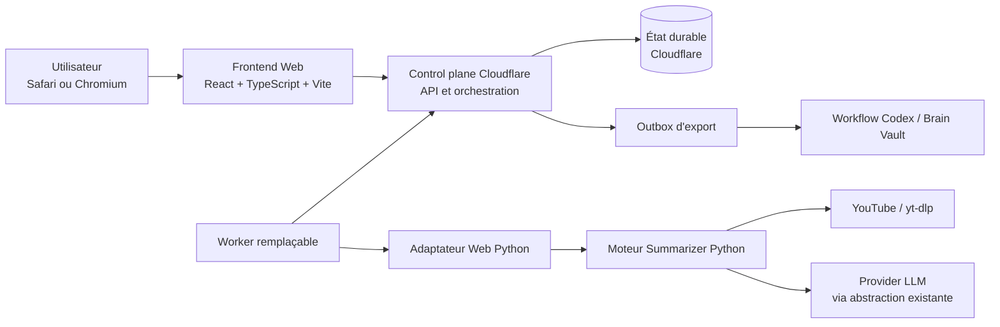
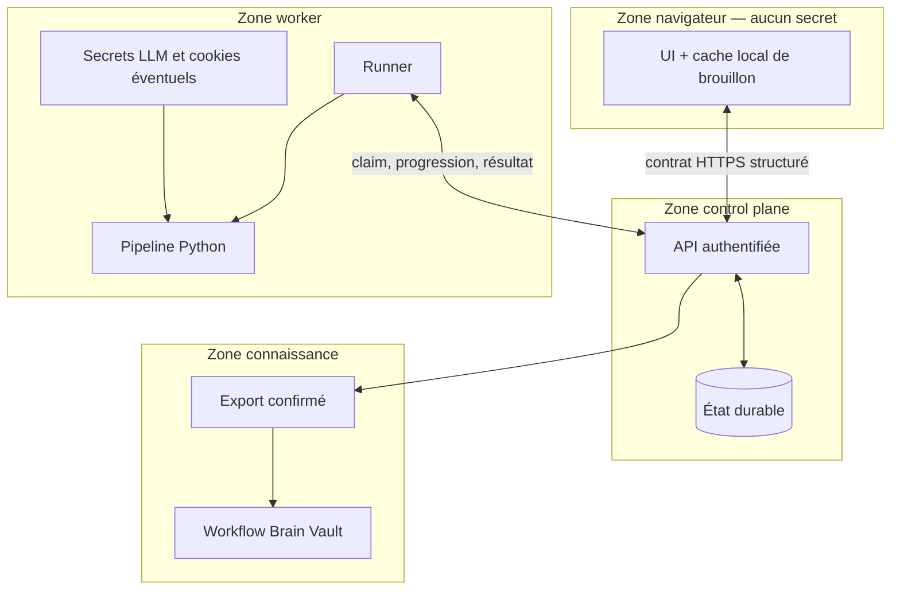
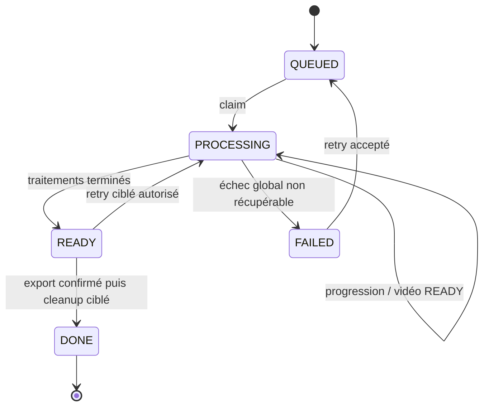

# Summarizer Web V1 — Architecture

> Statut : architecture fonctionnelle gelée pour la préparation de Web V1.
> Date de baseline : 2026-11-01.
> Cette note complète [ARCHITECTURE.md](ARCHITECTURE.md),
> [PIPELINE.md](PIPELINE.md), [SAFETY.md](SAFETY.md) et
> [UI_UX_SPEC.md](UI_UX_SPEC.md) sans les recopier.

## 1. Objectifs

Web V1 rend le pipeline YouTube existant utilisable depuis une interface progressive :

- soumettre une vidéo ou une playlist par URL ;
- traiter une playlist vidéo par vidéo ;
- rendre chaque résultat reviewable dès qu'il est prêt ;
- éditer une Note unique par vidéo ;
- conserver ou écarter avec Undo ;
- exporter les contenus gardés avant tout cleanup ;
- conserver un historique léger ;
- permettre de déplacer le worker sans réécrire le produit.

V1 encapsule le moteur Python. Elle ne crée pas un second pipeline.

## 2. Contraintes

- Le pipeline Python reste la source de vérité métier.
- Le navigateur ne lance jamais Python, `yt-dlp` ou un provider LLM directement.
- Aucun secret LLM, cookie YouTube ou chemin privé n'entre dans le bundle frontend.
- Le worker est remplaçable : environnement temporaire, Mac mini, puis VPS/container/pool.
- Une erreur vidéo n'arrête pas le reste d'une playlist.
- La progression est structurée ; aucun écran ne parse les logs du terminal.
- V1 Web est YouTube-only. Le pipeline PDF local reste intact.
- L'architecture reste minimale : pas de Kubernetes, Kafka, Redis, Celery, GraphQL, RAG, CQRS ou
  event sourcing complet sans besoin démontré.
- L'expérience est régie par [UI_UX_SPEC.md](UI_UX_SPEC.md).

## 3. Composants



Unités logiques :

- **Frontend** : navigation Home/Review/History et état d'interface.
- **Control plane** : validation, état produit, jobs, notes, décisions, finalisation et historique.
- **Worker** : réclame un travail, exécute l'adaptateur et publie progression/résultats/erreurs.
- **Adaptateur Python** : traduit le contrat Web vers le pipeline existant et ses résultats vers des
  événements structurés.
- **Pipeline Python** : extraction, transcript, résumé, model routing, usage et artefacts.
- **Stockage durable** : vérité des sources, vidéos, jobs, notes, décisions et exports.
- **Outbox Brain Vault** : frontière entre production de connaissance et organisation du vault.

## 4. Frontières



Interdictions de couplage :

- frontend → adresse du Mac mini ou du VPS ;
- frontend → provider LLM ;
- frontend → fichiers locaux `cache/`, `output/` ou `library/` ;
- control plane → parsing de sortie terminal ;
- pipeline Python → structure interne du Brain Vault ;
- worker → décision visuelle ou logique de navigation.

## 5. Frontend

La stack à préserver est React + TypeScript + Vite. Le frontend :

- implémente Home, Review, la fiche et History ;
- valide seulement la forme immédiate des entrées, le serveur restant autoritaire ;
- interroge l'état structuré du control plane ;
- garde un brouillon local de Note pour couvrir réseau et fermeture Safari ;
- applique une concurrence optimiste à partir de la version serveur ;
- ne contient aucun secret ni choix de provider ;
- n'interprète ni logs, ni fichiers de manifeste Python bruts.

Le polling HTTP borné suffit pour commencer si le transport validé ne prévoit pas déjà autre chose.
WebSocket ou Server-Sent Events ne sont introduits qu'avec un besoin observé et sans changer le
contrat de progression.

## 6. Control plane

Le control plane permanent vit sur Cloudflare et porte les responsabilités suivantes :

- authentifier et autoriser l'utilisateur et les workers ;
- créer une `Source` et un `Job` idempotents ;
- conserver l'état durable et les versions ;
- accorder un claim temporaire à un worker ;
- accepter des événements idempotents ;
- exposer les vidéos `READY` au frontend ;
- enregistrer Note, Garder, Écarter et Undo ;
- orchestrer export, confirmation puis cleanup ;
- produire un `HistoryEntry` léger ;
- conserver un diagnostic sûr lié par identifiant de corrélation.

La topologie Cloudflare exacte déjà décidée — Pages ou Static Assets, Worker(s), D1, éventuel Tunnel,
routes, domaines et politiques Access — n'est pas présente dans le dépôt ni dans le brief récupéré.
Ce document ne la redécide pas. Sa restitution dans le dépôt est un gate avant la Phase 2.

## 7. Worker

Un worker est un consommateur remplaçable du contrat de jobs. Il :

1. s'authentifie comme machine ;
2. réclame un job disponible ;
3. reçoit un claim avec expiration ;
4. renouvelle le claim pendant le traitement ;
5. exécute l'adaptateur Python ;
6. publie progression, artefacts structurés ou erreur ;
7. termine ou libère le claim proprement.

Le control plane refuse deux claims actifs pour le même travail. Un retry réutilise l'identité
logique du job et chaque événement possède une clé d'idempotence. Un claim expiré peut être repris ;
un résultat tardif d'un ancien claim ne peut pas écraser un résultat plus récent.

Le worker n'a pas besoin d'être joignable directement depuis le navigateur. Le transport physique
doit respecter la topologie Cloudflare déjà validée lorsqu'elle aura été restituée.

## 8. Pipeline Python

Le Web réutilise :

- `src.pipeline.run_video`, `run_playlist` et `_process_video` ;
- `src.extractors.youtube.YouTubeExtractor` ;
- `src.summarizers.video_summarizer.VideoSummarizer` ;
- `src.llm.factory`, `src.llm.model_router` et `src.llm.usage` ;
- `src.storage.manifest` comme source de compatibilité locale ;
- `src.exporters.graphipy` et `src.storage.retention` quand leurs contrats conviennent.

État observé le 2026-11-01 :

- la playlist est séquentielle et isole déjà les erreurs par vidéo ;
- le manifeste est sauvegardé après chaque vidéo ;
- les états actuels sont `pending`, `dry-run`, `done` et `failed` ;
- la progression intermédiaire n'existe que dans les messages Rich/terminal ;
- `done` signifie artefact produit, pas finalisation Web ;
- les transcripts peuvent être réutilisés depuis la bibliothèque locale ;
- le pipeline supprime son cache temporaire après archivage du transcript ;
- aucun contrat API, claim ou event sink n'existe encore.

L'adaptateur doit ajouter une frontière et des callbacks sans forker ni réécrire ces chemins. Les
statuts CLI restent compatibles ; l'adaptateur effectue le mapping vers le vocabulaire Web.

## 9. LLM

Le flux reste :

```text
transcript → VideoSummarizer → ModelRouter → LLMClient → provider
```

`create_llm_client()` supporte déjà Gemini, Anthropic et les providers OpenAI-compatible. Le Web ne
doit donc jamais introduire un client Gemini parallèle. Le modèle effectivement utilisé peut être
conservé dans la provenance du résultat, sans exposer clé, endpoint privé ni réponse brute d'erreur.

L'approfondissement contextuel réutilise cette même abstraction derrière une route serveur
authentifiée. Le navigateur transmet un contexte borné — titre, URL canonique, extrait sélectionné,
résumé et question — et reçoit une réponse Markdown et sa provenance de modèle. La route applique
validation de taille, contrôle d'origine, autorisation ressource, limite de fréquence, budget/coût et
timeout. La réponse reste éphémère tant que l'utilisateur ne l'ajoute pas explicitement à la Note.
Elle n'écrit jamais dans le résumé canonique.

Le fallback ChatGPT n'envoie pas silencieusement le contenu à un tiers : il copie un prompt local
borné et ouvre le site officiel. L'utilisateur reste responsable du collage et de l'envoi.

Les libellés CLI qui mentionnent encore Gemini sont une dette de vocabulaire, pas une raison de
modifier l'abstraction pendant la phase documentaire.

## 10. Stockage et état

Le modèle V1 reste petit. Tous les identifiants sont générés côté serveur et toutes les dates sont
stockées en UTC.

### Source

```text
Source
- id
- type = YOUTUBE
- kind = VIDEO | PLAYLIST
- canonical_url
- created_at
- active_job_id
```

### Playlist

```text
Playlist
- id
- source_id
- external_id si disponible
- title
- video_count
```

Pour une vidéo unique, aucun faux objet Playlist n'est nécessaire.

### Video

```text
Video
- id
- source_id
- playlist_id nullable
- external_video_id
- position nullable
- title
- canonical_url
- channel nullable
- status
- summary_artifact_ref nullable
- transcript_artifact_ref nullable
- model_used nullable
- provenance
```

### Job

```text
Job
- id
- source_id
- status
- stage
- progress nullable
- completed_items
- total_items nullable
- attempt
- claim_owner nullable
- claim_token_hash nullable
- claim_expires_at nullable
- last_event_seq
- public_error nullable
- diagnostic_ref nullable
- created_at / updated_at
```

### Note

```text
Note
- video_id (clé unique)
- body_markdown
- citations[] = { timestamp_seconds, text }
- version
- updated_at
```

`citations` est une structure interne de la Note unique, pas un système produit de highlights.

### ReviewDecision

```text
ReviewDecision
- video_id (clé unique)
- decision = PENDING | KEPT | DISCARDED
- version
- decided_at nullable
```

### HistoryEntry

```text
HistoryEntry
- id
- source_id
- source_title
- finished_at
- video_count
- kept_count
- final_status
- export_status
- export_destination
- export_receipt_id
```

Les artefacts lourds ne sont pas dupliqués dans History.

## 11. Job lifecycle

États communs obligatoires :

- `QUEUED` : accepté, pas encore réclamé ;
- `PROCESSING` : claim actif et traitement en cours ;
- `READY` : résultat exploitable pour Review ;
- `DONE` : workflow concerné finalisé avec succès ;
- `FAILED` : échec explicite, diagnostic disponible côté serveur.

Pour une playlist, le Job global peut rester `PROCESSING` pendant que certaines vidéos sont déjà
`READY`. Une vidéo passe à `READY` dès que transcript et résumé sont publiés. Le Job global ne passe
à `READY` qu'une fois la découverte et tous les traitements terminés ou isolés en échec. `DONE` est
réservé à la finalisation confirmée, pas à la simple génération du résumé.



Les sous-états `stage` sont machine-readable, évolutifs et distincts du statut : `DISCOVERING`,
`EXTRACTING`, `SUMMARIZING`, `PUBLISHING`, `EXPORTING` et `CLEANING` couvrent le besoin initial.

## 12. Communication

Le contrat logique minimal comprend :

- créer une source et son job ;
- lire état et progression ;
- lister les vidéos prêtes ;
- lire une vidéo et ses artefacts autorisés ;
- lire/écrire la Note avec contrôle de version ;
- écrire une décision et l'annuler ;
- demander une finalisation et lire son état ;
- lister History ;
- réclamer/renouveler/terminer un job côté worker ;
- publier un événement idempotent côté worker.

Exemple d'événement, indépendamment du transport :

```json
{
  "event_id": "evt_...",
  "job_id": "job_...",
  "video_id": "vid_...",
  "sequence": 7,
  "status": "PROCESSING",
  "stage": "SUMMARIZING",
  "progress": 0.5,
  "occurred_at": "2026-11-01T12:00:00Z"
}
```

Les routes HTTP, noms de tables et format d'artefact exacts sont des détails d'implémentation. Leurs
schemas doivent être partagés et testés entre frontend, control plane et adaptateur.

## 13. Secrets

- Frontend : aucune variable privée, notamment aucune clé préfixée pour être compilée par Vite.
- Control plane : seulement les secrets nécessaires à son authentification et à ses intégrations.
- Prototype macOS : clés utilisateur dans le Trousseau, jamais dans le bundle ou une réponse API.
- Worker : clés de service injectées par un gestionnaire de secrets ; une clé utilisateur n'est
  déchiffrée qu'en mémoire pour la durée de l'appel autorisé.
- Stockage durable applicatif : aucun secret LLM ou cookie en clair.
- Logs/diagnostics : valeurs sensibles redacted ; corps provider bornés et nettoyés.
- Dépôt : `.env`, `cookies.txt`, PDF, cache, outputs et données privées non versionnés.

Les variables publiques doivent être explicitement allow-listées. Une variable inconnue n'est pas
rendue publique par convention.

## 14. Notes

Une contrainte d'unicité sur `Note.video_id` garantit **une vidéo = une Note**. L'écriture utilise
une version optimiste :

1. le client lit la version `n` ;
2. il envoie contenu, citations et version attendue `n` ;
3. le serveur écrit seulement si la version courante vaut `n` ;
4. il renvoie `n + 1` ;
5. un conflit renvoie l'état serveur sans supprimer le brouillon local.

Le frontend sérialise ou annule ses requêtes afin d'ignorer une réponse obsolète. Le brouillon local
est une protection de reprise, pas une seconde source de vérité permanente.

Le texte éventuellement produit par l'IA n'est pas une entité canonique séparée. Il devient du
contenu utilisateur uniquement après **Ajouter à la Note**, avec un bloc de provenance indiquant le
modèle et la nécessité de vérifier. L'export d'une vidéo gardée inclut cette Note.

## 15. Review

Review lit les vidéos `READY` et leur décision. Garder/Écarter sont des mutations idempotentes et
versionnées. Undo restaure la décision précédente sans supprimer Note ou artefacts. Le serveur reste
autoritaire en cas de double action ou de reconnexion.

La fiche détaillée ne change pas de décision par swipe. Ce contrat appartient à
[UI_UX_SPEC.md](UI_UX_SPEC.md), pas au worker.

## 16. Export universel et Brain Vault

Summarizer produit une connaissance propre ; il n'organise pas le Brain Vault. La frontière V1 est
un export/outbox compatible avec le workflow réel :

```text
vidéos KEPT → paquet exportable → confirmation durable → workflow Codex/Vault
```

Le produit public fournit deux consommateurs universels :

- ZIP Markdown : `README.md`, manifeste JSON et un Markdown par vidéo gardée ;
- PDF propre : document de lecture et de partage.

Les connecteurs privés sont détectés par capacité et ne font pas partie du contrat public. Dans
l'installation locale du propriétaire, le connecteur Maxi Brain dépose atomiquement un paquet dans
`inbox/to_process/` avec le statut `to_process`. Il n'organise pas le vault et ne choisit pas son
classement final. Sur un hébergement public sans cette capacité, ce bouton n'est pas rendu.

Un paquet conservé contient au minimum :

- titre, URL, chaîne si disponible ;
- playlist et position si disponibles ;
- résumé ;
- Note unique ;
- transcript ou référence durable ;
- citations avec timestamps ;
- date et identifiants de provenance ;
- modèle utilisé si pertinent.

Le dépôt possède aujourd'hui `output/graphipy_ready/` et `export_graphipy_ready()`, qui copient un
Markdown. Ce mécanisme ne couvre pas encore la Note, la confirmation transactionnelle ou l'inbox
réelle du Vault. Tant que celle-ci n'est pas récupérée, l'outbox reste une frontière et aucun chemin
interne du Vault n'est inventé.

Retirer un reçu de History ne déclenche aucune suppression d'artefact. La rétention des paquets
exportés et leur éventuelle suppression sont des opérations séparées.

## 17. Cleanup

La règle est :

```text
sélection → export → confirmation → cleanup ciblé
```

Le control plane conserve un registre des artefacts appartenant au job. Seuls les artefacts
temporaires de ce registre peuvent être nettoyés. Les suppressions restent confinées aux racines
autorisées par `src.storage.retention.safe_delete`.

Interdictions :

- cleanup global de `input/`, `output/`, `cache/`, `playlists/` ou `library/` ;
- suppression immédiate après Écarter ;
- cleanup si l'export n'est pas confirmé ;
- chemin construit directement depuis une entrée utilisateur.

La politique de rétention de la bibliothèque canonique de transcripts doit être décidée séparément ;
elle n'est pas assimilée au cache de job.

## 18. Codespaces

Codespaces sert au développement depuis iPad et peut héberger un worker temporaire de test. Il ne
devient pas une dépendance irréversible du produit. Un rebuild doit être reproductible depuis GitHub
et les secrets Codespaces. Aucun résultat utilisateur ou état durable ne doit dépendre du disque
éphémère d'un Codespace.

## 19. Environnement actuel

Baseline du dépôt :

- application CLI Python 3.11 ;
- aucune application React, aucun `package.json`, aucune API Web ;
- manifests JSON locaux sous `cache/jobs/` ;
- fichiers Markdown sous `output/` ;
- bibliothèque de transcripts sous `library/youtube/` ;
- fournisseurs LLM abstraits ;
- CI : Black, Ruff, mypy non bloquant, detect-secrets et pytest ;
- 103 tests passent le 2026-11-01 ; Black et Ruff passent ; mypy remonte 20 erreurs existantes ;
- 896 transcripts et 896 métadonnées sont déjà suivis par Git malgré la règle de confidentialité.

Ce dernier point est une dette de sécurité préexistante : ne pas l'étendre et prévoir une remédiation
explicite avant exposition ou commercialisation.

## 20. Mac mini futur

Le Mac mini implémentera le même contrat worker : identité machine, claim, heartbeat, événements et
résultats. Ses chemins locaux, launch agents, volumes et cookies ne doivent jamais apparaître dans le
frontend ou le contrat produit. Il pourra ensuite exécuter les pipelines PDF/OCR lourds de V2.

## 21. VPS futur

Un VPS, container ou pool de workers remplace le Mac mini en conservant le même protocole. La V1 ne
construit ni scheduler distribué complexe ni autoscaling. Les prérequis de portabilité sont limités
à : configuration injectée, filesystem non canonique, claims temporaires, idempotence et artefacts
référençables.

## 22. V2 PDF

Le pipeline PDF existant reste local et inchangé en V1. V2 réutilisera Source, Job, Note, navigation,
Review et finalisation. Les différences prévues sont l'upload, la page à la place du timestamp, un
lecteur adapté et un worker plus lourd. Aucun endpoint PDF fictif n'est ajouté maintenant.

## 23. Sécurité

- authentification humaine Cloudflare selon la décision existante à restituer ;
- identité machine distincte et permissions minimales pour le worker ;
- autorisation serveur sur chaque Source, Video, Note, décision et export ;
- validation stricte de l'URL YouTube, des IDs, tailles, versions et transitions d'état ;
- protection CSRF si l'authentification repose sur cookies ;
- CORS limité à l'origine attendue ;
- limites de taille et de fréquence sur mutations et événements ;
- contexte IA minimisé et borné, modèle appelé côté serveur, timeout et budget par utilisateur ;
- défense en profondeur contre les instructions présentes dans le contenu source : elles restent
  des données et ne peuvent déclencher ni outil, ni export, ni décision projet ;
- hash des tokens de claim, jamais leur valeur brute en base ;
- diagnostics séparés des messages utilisateur ;
- noms de fichiers générés côté serveur et contrôlés dans une racine autorisée ;
- dépendances et builds soumis à la CI et au secret scan.

### Coffre de clés utilisateur

Le prototype local expose une route same-origin **Clés API** et conserve les secrets uniquement
côté serveur dans le Trousseau macOS. Il ne renvoie au frontend que des booléens `configured` et le
type de stockage, jamais les valeurs. L'écriture transmet la clé au processus Trousseau par entrée
standard, sans argument de commande ni variable d'environnement. Le processus Gemini enfant reçoit
également sa clé par entrée standard bornée.

Le serveur de prototype écoute sur loopback par défaut. Les routes Clés API, Gemini et Maxi Brain
refusent les clients non loopback ; toute mutation exige aussi une origine navigateur explicite qui
correspond au `Host`. Cette barrière locale ne remplace pas l'authentification du futur backend SaaS.

Les variables d'environnement restent un fallback legacy/headless. Si une clé Gemini est détectée
dans `.env`, la migration l'écrit dans le Trousseau, la relit pour vérifier l'intégrité, puis retire
atomiquement les seules lignes Gemini du fichier. Une suppression avant vérification est interdite.

La production ne reprend pas ce stockage mono-utilisateur : elle exige un coffre chiffré par
utilisateur avec chiffrement par enveloppe/KMS, authentification, autorisation par tenant, identité de
service minimale, rotation/révocation et audit des métadonnées sans valeur secrète. Aucun écran ni
route d'administration ne peut révéler une clé. Les usages logiques sont `gemini_summary` et
`gemini_deep_dive`. Une erreur provider de quota est normalisée en code produit stable, sans
transmettre le corps brut du provider au navigateur.

Ce modèle protège les secrets au repos et limite leur exposition, mais n'est pas « zero knowledge » :
le service qui appelle Gemini doit pouvoir déchiffrer la clé en mémoire. De même, le Trousseau ne
protège pas contre un attaquant contrôlant déjà la session macOS déverrouillée. Ces limites doivent
figurer dans le threat model avant la mise en production.

## 24. Failure modes

| Échec | Comportement attendu | Donnée protégée |
| --- | --- | --- |
| URL invalide | Refus avant création coûteuse | Aucun job parasite |
| Playlist inaccessible | Job `FAILED`, retry possible | Source et diagnostic sûr |
| Transcript absent | Vidéo `FAILED`, suite de playlist continue | Autres vidéos |
| LLM indisponible | Vidéo `FAILED` ou retry ciblé | Transcript et tentative |
| Worker arrêté | Claim expire puis reprise | Événements déjà acceptés |
| Événement dupliqué | Déduplication par `event_id`/séquence | État courant |
| Deux workers | Un seul claim actif | Job non dupliqué |
| Réponse autosave ancienne | Rejet/ignorée par version | Note la plus récente |
| Réseau mobile perdu | Brouillon local puis resynchronisation | Texte utilisateur |
| Approfondissement IA indisponible | Note intacte, retry ou fallback copier/ouvrir | Résumé et Note |
| Clé Gemini absente | Ouvrir Clés API avant envoi | Aucun contenu transmis |
| Quota Gemini épuisé | Popup, reprise après renouvellement/changement de clé | Job et Note intacts |
| Export Vault échoué | Pas de cleanup, reprise possible | Vidéos gardées |
| Cleanup partiel | Étapes idempotentes et diagnostic | Export confirmé |
| Erreur backend | Message public neutre + corrélation | Secrets et internals |

## 25. Décisions figées et détails ouverts

### FROZEN ARCHITECTURE DECISIONS

- Web V1 est YouTube-only ; le PDF local est conservé pour V2.
- L'UX Home/Review/History et les interactions de [UI_UX_SPEC.md](UI_UX_SPEC.md) sont figées.
- La direction visuelle C **Fluid Knowledge** est la cible validée depuis le 2026-11-06 ; sa
  référence mobile est `docs/assets/web-v1-fluid-knowledge-review-mobile.png`.
- Le frontend conserve React + TypeScript + Vite.
- GitHub est la source ; Codespaces est un environnement de développement, pas le runtime produit.
- Cloudflare porte l'interface permanente et le control plane selon la topologie déjà validée.
- Le worker est remplaçable et n'est jamais adressé directement par le frontend.
- Le pipeline Python existant reste l'unique moteur métier.
- L'abstraction LLM existante est conservée ; aucun appel provider depuis le navigateur.
- Les états communs sont `QUEUED`, `PROCESSING`, `READY`, `DONE`, `FAILED`.
- Une vidéo possède une Note unique ; l'autosave est versionné et résistant aux réponses obsolètes.
- Une playlist est progressive et les erreurs vidéo sont isolées.
- Garder/Écarter sont réversibles et n'entraînent aucune suppression immédiate.
- Finaliser respecte sélection → export → confirmation → cleanup ciblé.
- Summarizer produit et exporte ; le workflow Codex/Vault organise ; Brain Vault conserve.
- Aucune clé, cookie ou donnée privée n'entre dans le frontend ou dans Git.
- La V1 évite l'infrastructure distribuée inutile sans sacrifier idempotence, erreurs et provenance.

### OPEN IMPLEMENTATION DETAILS

Ces points ne rouvrent pas l'architecture produit. Ils doivent être récupérés ou fixés avant leur
phase d'implémentation :

- restitution exacte de la topologie Cloudflare validée : Pages/Static Assets, Worker(s), D1,
  Tunnel éventuel, routes, domaines et Access ;
- emplacement exact dans le monorepo des packages frontend et control plane ;
- forme précise des tables/migrations et des routes HTTP ;
- polling, SSE ou autre transport déjà retenu pour la progression ;
- durée des claims, cadence heartbeat et politique de retry ;
- stockage physique des artefacts lourds et durée de rétention ;
- mécanisme réel d'inbox/confirmation Brain Vault ;
- déclinaison de la référence **Fluid Knowledge** sur iPad/Mac et validation interactive de ses
  gestes, états et tokens ;
- interaction exacte de sélection transcript sur Safari mobile ;
- politique de remédiation des transcripts/métadonnées déjà suivis par Git ;
- correction ou acceptation explicite des 20 erreurs mypy préexistantes.
